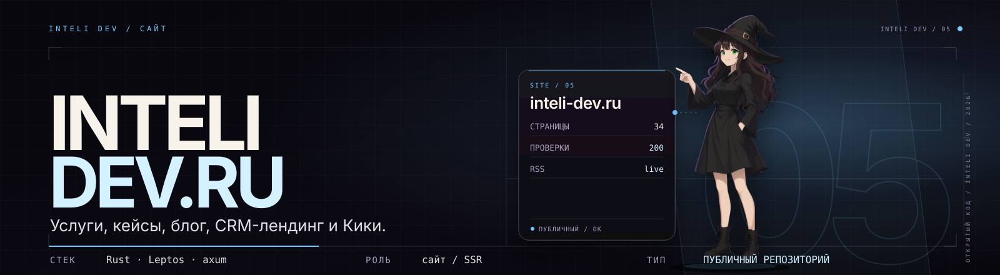

# inteli-dev.ru



Личный сайт специалиста по SEO и разработке: витрина услуг, кейсы, блог, CRM-лендинг и ассистент Кики. Один домен, один контур: посетитель читает, задаёт вопрос и оставляет заявку без переходов между сервисами.

Философия простая: меньше кнопок и текста, больше пользы. Заявка должна занимать несколько действий, а не квест по страницам. Подробные правила — в [`AGENT.md`](AGENT.md).

## Что внутри

| Раздел | Путь | Что делает |
|---|---|---|
| Главная | `/` | позиционирование, услуги, кейсы, быстрый вход в чат и заявку |
| Услуги | `/services`, `/services/{slug}` | SEO, аудит, разработка и сопровождение |
| Проекты | `/projects`, `/projects/{slug}` | кейсы с контекстом и результатом |
| Блог | `/blog`, `/blog/{slug}` | статьи и технические разборы |
| Чат | `/chat` | диалог с Кики, история и быстрые сценарии |
| CRM-лендинг | `/crm` | отдельная посадочная страница CRM с кинетической иллюстрацией |
| Админка | `/admin/*` | заявки, чаты, статьи, прайс и outbox |
| API | `/api/*` | health, статус, чат, заявки, вебхук Telegram |

## Стек

| Компонент | Технология |
|---|---|
| UI | Leptos 0.7.8 (SSR) + ванильный JS |
| HTTP | axum 0.7, tokio, tower |
| Хранилище | SQLite (WAL, sqlx) |
| Контент | встроенный реестр `src/memory/content.rs` |
| LLM | DeepSeek через OpenAI-compatible endpoint |
| Уведомления | Telegram Bot API + VK Messages API |
| Деплой | Docker multi-stage, лёгкий runtime |

## Структура

```text
src/
├── main.rs            boot: конфигурация → слои → сервер
├── lib.rs             библиотека и сборка роутера
├── config.rs          config.toml + переменные окружения
├── api/               HTTP-хендлеры: chat, lead, status, health, admin
├── services/          бизнес-логика: чат, заявки, статус, SEO
├── storage/           SQLite: чаты, лиды, статьи, прайс
├── memory/            встроенный контент и страницы услуг
├── llm/               ChatProvider, DeepSeek и промпты
├── notification/      Telegram и VK
├── cache.rs           in-memory кэш и rate limiter
├── utils/             валидация, анонимизация IP
└── ui/                Leptos SSR: home, services, blog, chat, crm, admin
assets/                style.css, main.js, изображения и шрифты
tests/                 интеграционные тесты API и страниц
RULES/                 архитектурные и UI-правила
docs/                  ADR и эксплуатационные заметки
```

## Быстрый старт

### Локально

Нужен Rust 1.85+.

```bash
cp config.toml.example config.toml
cargo run
# → http://localhost:8080
```

Секреты задаются через env (`LLM_API_KEY`, `TELEGRAM_BOT_TOKEN`, `ADMIN_TOKEN`, …)
или `config.toml`. Без ключей сайт работает: чат отвечает fallback-ответами,
уведомления пропускаются.

### Docker dev

```bash
cp .env.example .env
docker compose -f compose.dev.yaml up -d --build
# → http://localhost:8282
```

### Docker prod

Продакшен — канонический `compose.yaml`: приложение за nginx, трафик и TLS
через внешний Traefik (сеть `traefik-public`), сертификат Let's Encrypt
выпускается автоматически. Контейнеры и тома имеют префикс `inteli-dev-prod`,
поэтому production можно держать рядом с dev-стеком.

```bash
cp .env.prod.example .env.prod
docker compose up -d --build
```

Требования к серверу:

- внешняя docker-сеть Traefik: `docker network create traefik-public`;
- A-запись `inteli-dev.ru` и `www` на этот сервер, иначе ACME HTTP-01 не пройдёт.

Конфигурация приложения — `config/config.prod.toml` (монтируется read-only как
`/app/config.toml`, секретов в нём нет). Подробности — [`RULES/docker-build.md`](RULES/docker-build.md).

## API

| Метод | Путь | Описание |
|---|---|---|
| GET | `/api/health` | health-check |
| GET | `/api/status` | статус занятости |
| POST | `/api/chat` | AI-чат |
| POST | `/api/lead` | заявка/лид → Telegram + VK |
| POST | `/api/telegram/webhook` | webhook Telegram |
| GET | `/api/admin/stats` | сводка (Bearer `ADMIN_TOKEN`) |
| GET | `/api/admin/leads` | список лидов |
| GET | `/api/admin/chats` | история чатов |
| PATCH | `/api/admin/leads/{id}` | смена статуса |

## Кики и CRM

Кики — общий ассистент сайта и CRM. Ядро живёт в
[`inteli-dev-kiki-assistant-kernel-api`](../inteli-dev-kiki-assistant-kernel-api/README.md):
оно хранит диалоги, инструменты и маршрутизацию моделей. Сайт отдаёт ядру
контекст страницы и принимает tool calls; CRM подключается к тому же ядру.

CRM-лендинг `/crm` — отдельная кинетическая сцена: Кики, орбиты, карточки
клиентов и задач. Она собрана из тех же токенов, что и остальной сайт, и не
тянет внешний фреймворк.

## Тесты

```bash
cargo test
cargo clippy --all-targets --all-features
cargo fmt --check
```

## Документация

- [`AGENT.md`](AGENT.md) — правила разработки, дизайна и деплоя.
- [`RULES/`](RULES/) — архитектура, UI, Docker, безопасность.
- [`docs/ADR.md`](docs/ADR.md) — архитектурные решения.
