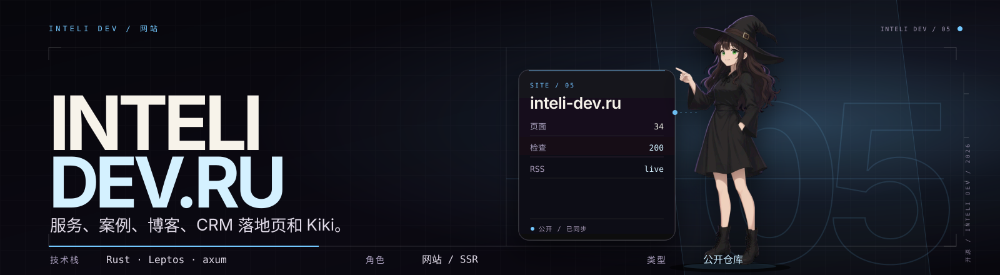

# inteli-dev.ru



[English](README.md) · [Русский](README.ru.md) · [中文](README.zh_CN.md)

面向 SEO 与开发工作的个人网站：服务、案例、博客、CRM 落地页和 Kiki 助手。一个域名、一个流程：访客阅读、提问并留下需求，不需要在多个服务之间跳转。

更少的按钮和噪音，更多有用的信息。详细规则见 [`AGENT.md`](AGENT.md)。

## 页面

| 页面 | 路径 | 作用 |
|---|---|---|
| 首页 | `/` | 定位、服务、案例、聊天和需求入口 |
| 服务 | `/services`、`/services/{slug}` | SEO、审计、开发与支持 |
| 项目 | `/projects`、`/projects/{slug}` | 带背景和结果的案例 |
| 博客 | `/blog`、`/blog/{slug}` | 文章与技术笔记 |
| 聊天 | `/chat` | 与 Kiki 对话，包含历史和快捷场景 |
| CRM 落地页 | `/crm` | 带动态 Kiki 场景的 CRM 页面 |
| 管理 | `/admin/*` | 线索、聊天、文章、价格和 outbox |
| API | `/api/*` | health、状态、聊天、线索和 Telegram webhook |

## 技术栈

| 层 | 技术 |
|---|---|
| UI | Leptos 0.7.8（SSR）+ 原生 JS |
| HTTP | axum 0.7、tokio、tower |
| 存储 | SQLite（WAL、sqlx） |
| 内容 | 内置注册表 `src/memory/content.rs` |
| LLM | 通过 OpenAI 兼容接口调用 DeepSeek |
| 通知 | Telegram Bot API + VK Messages API |
| 部署 | 多阶段 Docker，精简运行时 |

## 结构

```text
src/
├── main.rs            boot：配置 → 分层 → 服务
├── lib.rs             库与路由组装
├── config.rs          config.toml + 环境变量
├── api/               HTTP 处理器：chat、lead、status、health、admin
├── services/          聊天、线索、状态、SEO、可用性
├── storage/           SQLite：聊天、线索、文章、价格
├── memory/            内置内容和业务页面
├── llm/               ChatProvider、DeepSeek 和提示词
├── notification/      Telegram 与 VK
├── cache.rs           内存缓存和限流
├── utils/             校验、IP 匿名化
└── ui/                Leptos SSR：home、services、blog、chat、crm、admin
assets/                style.css、main.js、图片和字体
tests/                 API 与页面集成测试
RULES/                 架构与 UI 规则
docs/                  ADR 与运维笔记
```

## 快速开始

### 本地

需要 Rust 1.85+。

```bash
cp config.toml.example config.toml
cargo run
# → http://localhost:8080
```

密钥来自环境变量（`LLM_API_KEY`、`TELEGRAM_BOT_TOKEN`、`ADMIN_TOKEN` 等）或 `config.toml`。没有密钥时网站仍可运行：聊天返回兜底回答，通知被跳过。

### Docker 开发

```bash
cp .env.example .env
docker compose -f compose.dev.yaml up -d --build
# → http://localhost:8282
```

### Docker 生产

生产使用标准 `compose.yaml`：应用位于 nginx 之后，流量和 TLS 通过外部 Traefik 网络（`traefik-public`），Let's Encrypt 自动签发证书。容器和卷使用 `inteli-dev-prod` 前缀，因此生产环境可以和开发栈并行。

```bash
cp .env.prod.example .env.prod
docker compose up -d --build
```

服务器要求：

- 外部 Traefik Docker 网络：`docker network create traefik-public`；
- `inteli-dev.ru` 和 `www` 的 A 记录指向该服务器，否则 ACME HTTP-01 无法通过。

应用配置在 `config/config.prod.toml`（以只读方式挂载为 `/app/config.toml`，不含密钥）。详见 [`RULES/docker-build.md`](RULES/docker-build.md)。

## API

| 方法 | 路径 | 说明 |
|---|---|---|
| GET | `/api/health` | 健康检查 |
| GET | `/api/status` | 可用状态 |
| POST | `/api/chat` | AI 聊天 |
| POST | `/api/lead` | 线索 → Telegram + VK |
| POST | `/api/telegram/webhook` | Telegram webhook |
| GET | `/api/admin/stats` | 汇总（Bearer `ADMIN_TOKEN`） |
| GET | `/api/admin/leads` | 线索列表 |
| GET | `/api/admin/chats` | 聊天历史 |
| PATCH | `/api/admin/leads/{id}` | 修改线索状态 |

## Kiki 与 CRM

Kiki 由网站和 CRM 共用。内核位于 [`inteli-dev-kiki-assistant-kernel-api`](../inteli-dev-kiki-assistant-kernel-api/README.md)：负责对话、工具和模型路由。网站发送页面上下文并接收 tool calls；CRM 连接同一个内核。

`/crm` 落地页使用网站设计令牌构建动态场景：Kiki、轨道环、客户和任务卡片。不引入额外前端框架。

## 测试

```bash
cargo test
cargo clippy --all-targets --all-features
cargo fmt --check
```

## 文档

- [`AGENT.md`](AGENT.md) — 开发、设计与部署规则。
- [`RULES/`](RULES/) — 架构、UI、Docker、安全。
- [`docs/ADR.md`](docs/ADR.md) — 架构决策。
